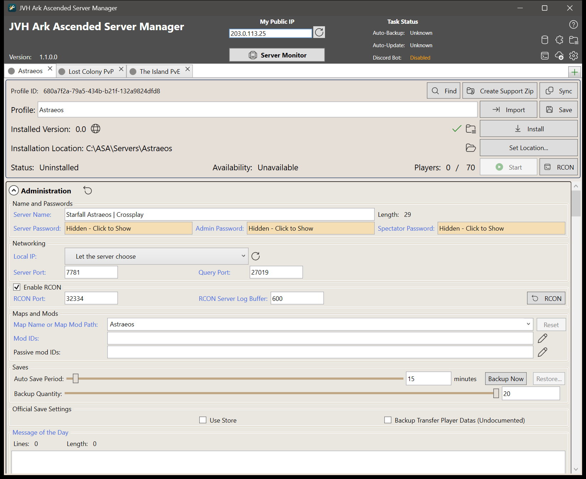
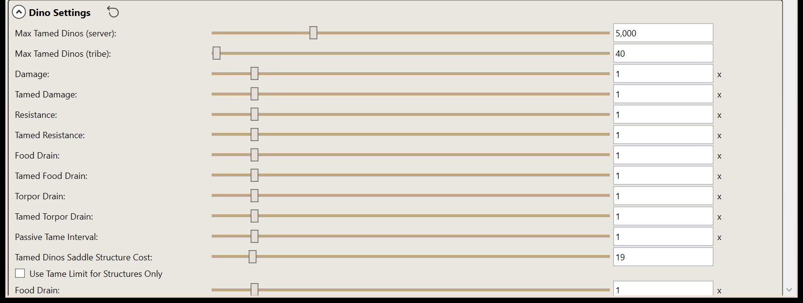
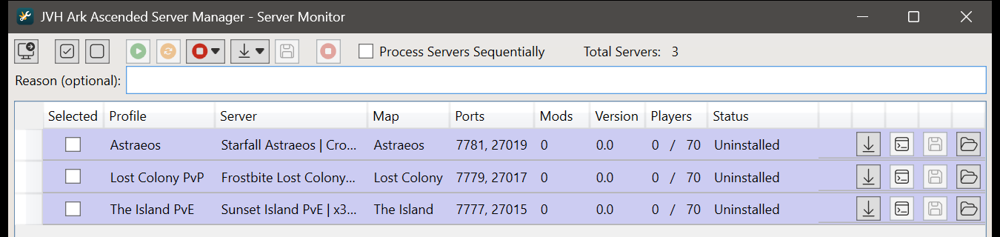

# JVH Ark Ascended Server Manager

A Windows app for running **ARK: Survival Ascended** dedicated servers. It installs and updates them through
SteamCMD, edits their settings, starts and stops them safely, backs up their saves, and keeps an eye on them while
they run, for one server or several on the same machine.



It is a fork of [ARK Server Manager](https://github.com/Bletch1971/ServerManagers) by Bletch, reworked for
ARK: Survival Ascended. It doesn't support ARK: Survival Evolved servers.

**Status:** in development; there is no release to download yet. You can [build it from source](#building-from-source).

## Contents

- [Features](#features)
- [Requirements](#requirements)
- [Setting up a server](#setting-up-a-server)
- [Running it day to day](#running-it-day-to-day)
- [Where things are kept](#where-things-are-kept)
- [Troubleshooting](#troubleshooting)
- [Building from source](#building-from-source)
- [Credits, license and disclaimer](#credits)

## Features

**Servers**

- Installs and updates the ASA dedicated server (Steam app 2430930) through SteamCMD, which the app downloads
  itself. Beta branches, file validation, and an update before each start if you want one.
- Any number of servers on one machine, each with its own profile, install folder and ports.
- Crossplay: choose which platforms can join (PC through Steam or the Microsoft Store, Xbox, PlayStation).

**Settings**

- One settings page per server for `GameUserSettings.ini`, `Game.ini` and the launch options, grouped into
  sections: Administration, Rules, Chat and Notifications, HUD and Visuals, Player Settings, Dino Settings,
  Environment, Structures, Engrams, level progressions, and overrides for crafting, stack sizes, map spawners,
  supply crates and transfers. The ASA-only options are there, and options ASA dropped are gone.
- **Find** searches all settings by name; **Sync** copies settings from one profile to others; **Import** loads
  a profile or takes one over from an existing server installation; custom sections take any INI line the app
  doesn't cover.
- Game data for the official maps, creatures, items, engrams, spawners and supply crates, including Lost Colony,
  Astraeos and Bob's Tall Tales content.



**Mods**

- Mods by CurseForge project ID (and passive mods, loaded but turned off). The server downloads and updates them
  itself.
- A mod list editor to add IDs or curseforge.com links, reorder mods, open their CurseForge pages, and see each
  mod's name and installed version once the server has downloaded it.

**Running servers**

- Start, stop and restart. **Stop** saves the world and shuts the server down cleanly; **Shutdown** counts down
  with messages to players in chat, and can update, restart and back up afterwards.
- Status and player count for every server (through RCON).
- An RCON window: chat, the player list with each player's profile and tribe (read from the save files), kick and
  ban, and any server command.

**Automation and backups**

- Scheduled tasks: start a server when Windows starts or you log in, shut it down at set times (with an update and a
  restart), and include it in the automatic backup and update cycles.
- World and player-file backups on demand or on a schedule, and a restore window that also lists the server's own
  backups.

**Everything at once**

- The Server Monitor shows all servers in one window and starts, stops, restarts, updates or backs up several at
  once. It can make a desktop shortcut that opens it directly.



**Discord**

- An optional Discord bot to check and control servers from a Discord channel: `info`, `status`, `list`, `start`,
  `stop`, `shutdown`, `restart`, `update`, `backup` and `help`.
- Plugin support. The source includes a Discord plugin (`src/Plugin.Discord`) that posts server alerts to Discord
  through webhooks; it's built separately and added from the Plugins window.

The interface is in English, German, Spanish, French, Brazilian Portuguese, Russian, Turkish and Simplified
Chinese. Texts added for ASA are in English only so far.

## Requirements

- Windows 10 or 11, 64-bit.
- The [.NET 11 Desktop Runtime](https://dotnet.microsoft.com/download/dotnet/11.0) (x64).
- About 12 GB of disk space per server, plus room for saves and backups.
- Administrator rights for firewall rules and scheduled tasks. Everything else works without them.

## Setting up a server

### 1. Put the app in a permanent folder

Extract the app to a folder you'll keep, such as `C:\Tools\ASA Server Manager`. Scheduled tasks and desktop
shortcuts point at the app's location, and later versions are installed by extracting them over the same folder.

### 2. First start

When the app starts it offers to restart as administrator. Say yes if you want it to open the server's ports in
Windows Firewall and to create scheduled tasks; you can turn the prompt off in Settings.

On the first start it asks for a **data folder** (suggested name: `asadata`). Profiles, SteamCMD, logs and, by
default, the servers and backups go there. It isn't the server's install folder: each server can be installed
wherever you choose. Pick a drive with room for the servers.

### 3. Add a profile and install the server

1. Click **+** at the right end of the tab bar to add a profile, and give it a name in **Profile**.
2. The install location defaults to a folder in the data folder; **Set Location...** changes it.
3. Click **Install**. The app downloads SteamCMD if needed, then the server, about 12 GB. When it's done, the
   installed version shows next to **Installed Version**.

### 4. Set it up

Open the **Administration** section:

- **Server Name**: the name players see in the server list.
- **Server Password** (optional, to keep the server private) and **Admin Password**. A new profile gets a
  generated admin password: it's what you use for admin commands in the game, and what the app uses for RCON.
- **Players from**: the platforms that can join.
- **Map Name or Map Mod Path**: one of the official maps, or a mod map's path.
- **Mod IDs**: CurseForge project IDs separated by commas, or use the pencil button for the mod list editor.
- **Server Port**, **Query Port** and **RCON Port**: the defaults are fine for one server. Give each extra server
  its own ports.

Then go through the other sections for the rules you want; hover over a setting to see what it does. Click
**Save** when you're done: the app writes
`GameUserSettings.ini`, `Game.ini` and the launch script into the server's folder.

### 5. Start it

Click **Start**. The server takes a few minutes to start; the status goes to **Running / Available** once it's
ready for players, and the player count shows next to **Players**.

### 6. Let players in

| Port | Default | Protocol | Forward on your router? |
|---|---|---|---|
| Server (game) port | 7777 | UDP | Yes, for players outside your network |
| Query port | 27015 | UDP | Not needed: ASA servers are listed through Epic Online Services |
| RCON port | 32330 | TCP | No: the app uses it on the same machine |

With **Manage firewall settings automatically** on (in Settings) and the app running as administrator, the app
opens the ports in Windows Firewall itself. Players find the server in the game's unofficial server list by its
name.

### 7. Automate it (optional)

Open the **Automatic Management** section of the profile (it needs the app to run as administrator):

- **Auto-Start server** on boot or on login.
- **Shutdown server at** up to two times a day, on chosen days, with an update and a restart.
- **Include server in the Auto-Backup cycle** and **in the Auto-Update cycle**. How often those run is set in
  Settings, under Backup Settings and Auto Update.
- **Restart server if shutdown**: the automatic update starts the server afterwards even if it wasn't running.

### 8. The Discord bot (optional)

1. Create a bot in the [Discord Developer Portal](https://discord.com/developers/applications) and invite it to
   your Discord server. The **Help...** button next to the bot settings links to Discord's guide.
2. In Settings, turn on **Enable Discord Bot** and enter its **Token**, your Discord **Server Id** and a
   command **Prefix** such as `!asa `.
3. In each profile's **Discord Bot Details**, enter the **Channel Id** the bot listens to for that server, and
   optionally an **Alias** to use in commands.
4. Restart the app. In the channel, type the prefix and `help` to see the commands.

## Running it day to day

- **Stop** (in the profile or the Server Monitor) saves the world, then shuts the server down. **Shutdown** opens a
  countdown that warns players in chat; choose whether to update, restart or back up afterwards.
- **RCON** opens the remote console for a running server.
- **Backup Now** and **Restore...** are in the Administration section, under Saves.
- **Server Monitor** (main window header) handles several servers at once; tick them and use the toolbar.
- **Updating the app:** close it and extract the new version over the old folder. Your settings, profiles and
  servers are kept.

## Where things are kept

| What | Where |
|---|---|
| Profiles | `Profiles` in the data folder |
| SteamCMD | `SteamCMD` in the data folder |
| Servers | `Servers` in the data folder, unless you chose another install location |
| Backups | the backup folder set in Settings |
| The app's logs | `Logs` in the data folder (the logs button in the main window header opens it) |
| Server settings | `ShooterGame\Saved\Config\WindowsServer` in each server's folder |
| App settings | your Windows user profile, with a backup (`userconfig.json`) in the app's folder |

## Troubleshooting

- **The player count shows "–":** the app can't read it. Hover over it to see why: RCON is off, the server hasn't
  answered yet (normal while it starts), or it rejected the admin password.
- **"Why can't I use this?" in Automatic Management:** the app isn't running as administrator, which scheduled
  tasks need. Restart it and accept the administrator prompt.
- **Players can't find or join the server:** check that the server port (UDP) is forwarded to this machine and
  open in Windows Firewall, and that the status is **Running / Available**.
- **Something else:** the server's own logs are in `ShooterGame\Saved\Logs` in its folder, and the app's in the
  data folder's `Logs`. **Create Support Zip** in the profile collects the files needed to diagnose a problem
  into one zip.

## Building from source

You need the .NET 11 SDK on Windows.

```powershell
dotnet build src\ARKServerManager -c Release
```

The app is built to `src\ARKServerManager\bin\Release\net11.0-windows`. Don't zip that folder for others: a copy
of the app that has been run writes its settings backups (`userconfig.json`, `commonconfig.json`) into it.

To run the unit tests: `dotnet test src\Server-Managers.slnx`.

To make a release zip, commit your changes and run:

```powershell
tools\Release\Build-Release.ps1                  # version from src\Directory.Build.props
tools\Release\Build-Release.ps1 -Version 1.2.0
```

It makes a clean build in its own folder, adds this README, the changelog and the third-party notices, checks
that no settings backup, updater or debug symbols got in, and writes
`artifacts\JVH-Ark-Ascended-Server-Manager-<version>.zip`. The version must stay above 1.0, or the app won't
carry users' settings over from earlier builds.

### Publishing a release

GitHub Actions builds every push to `main` and runs the tests (`.github/workflows/build.yml`). Releases are
published from a version tag (`.github/workflows/release.yml`):

1. Set the new `<Version>` in `src\Directory.Build.props`, and turn `## [Unreleased]` in the changelog into
   `## [1.2.0] - <date>`.
2. Commit, then tag the commit and push both:

   ```powershell
   git tag v1.2.0
   git push origin main v1.2.0
   ```

The workflow checks that the tag matches `<Version>` and that the changelog has that version's section, runs the
tests, builds the zip with `Build-Release.ps1`, and publishes a GitHub release with the zip, its `.sha256` file and
the changelog section as release notes. Running it by hand (Actions, Release, Run workflow) makes a trial build:
the zip is kept as a workflow artifact for a week, and nothing is released.

- `docs/PORTING-PLAN.md` explains what was changed for ASA and why.
- `tools/UiDriver` can drive the app's UI from a shell for testing.
- `tools/Icons/Build-Icons.ps1` generates the app's icons; see the comment at its top to add or change one.

## Changes

See [CHANGELOG.md](CHANGELOG.md).

## Credits

- **[ARK Server Manager](https://github.com/Bletch1971/ServerManagers)** by Bletch (Brett Hewitson), which this
  app is built on, with contributions from Lacoi and others.
- **Game data** (creature, item and engram names and engram levels) includes content from the
  [ARK Wiki](https://ark.wiki.gg/) by its contributors, licensed under
  [CC BY-NC-SA 4.0](https://creativecommons.org/licenses/by-nc-sa/4.0/).
- **Icons:** [Fluent UI System Icons](https://github.com/microsoft/fluentui-system-icons) by Microsoft, MIT License.
- **Third-party libraries:** see [THIRD-PARTY-NOTICES.md](THIRD-PARTY-NOTICES.md).

## License

Not decided yet. The original ARK Server Manager has no license file.

## Disclaimer

ARK: Survival Ascended is a trademark of Studio Wildcard. This project is not affiliated with or endorsed by
Studio Wildcard or Snail Games.
